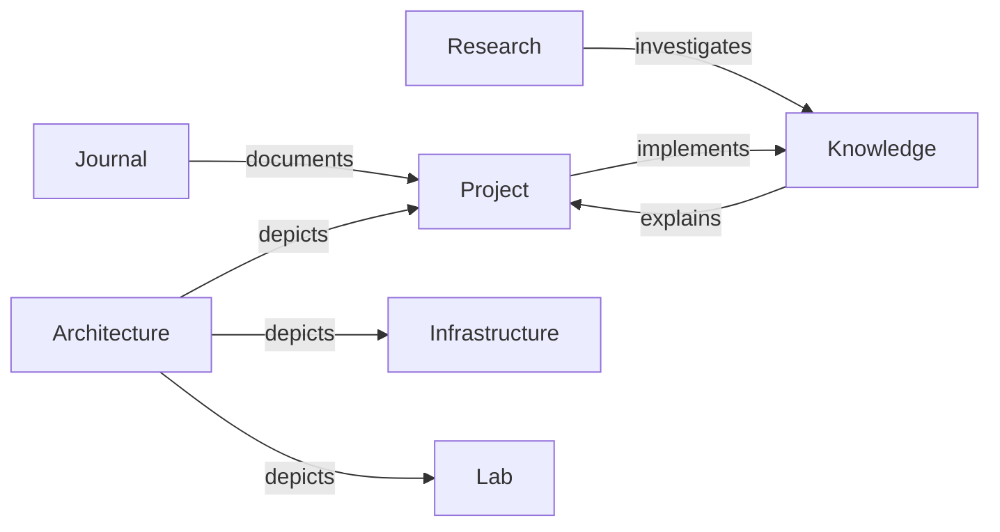
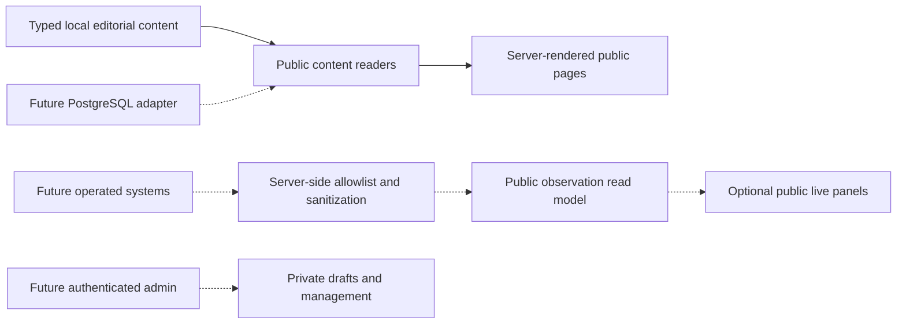

# AJTECH portfolio: information architecture

> **Update (November 2026):** the portfolio was repositioned around security
> engineering and research. The current public routes, navigation, and content
> are described in [the portfolio audit](../portfolio-audit.md) and
> [the route guide](../../apps/web/app/ROUTES.md). Sections below that describe
> Project 001/002, the journal, or infrastructure outlines are historical; the
> reservation and data-contract principles still apply.

Status: the route and data contracts below include future reservations. They are
not evidence that a backend, authentication, telemetry, database, AI service, or
self-hosted deployment exists. The public frontend is a static export on GitHub Pages.

## 1. Existing foundation and decisions

- One Next.js App Router application in `apps/web`, within the current pnpm workspace.
- Root layout owns the skip link, header, main landmark, and footer.
- `/`, `/about`, `/work`, `/work/[slug]`, `/writing`, `/journal`, `/journal/[slug]`, `/research`, and `/research/[slug]` are implemented.
- Project 001 documents the portfolio implementation. Project 002 is a published plan for an Infrastructure Engineering Lab, not an operational system. One published engineering log and six research outlines are also available as local content.
- `getProjects` and `getProjectBySlug` supply typed records to Server Components. The homepage and project archive use the same project record.
- Preserve the modular monolith, workspace, lockfiles, validation scripts, current layouts and visual tokens.
- Reserve unfinished routes in `platform-routes.ts`, not with empty live pages. No catch-all route will manufacture placeholders.
- A complete route plan is not a promise that content, a service, or an operational system exists.

## 2. Current route tree and reservations

Legend: **implemented** means the current application serves the page. Everything
else is **reserved**, not publicly routable. Dynamic entries require a published
record; unknown slugs return 404. No additional dynamic detail patterns are needed
for Lab, Infrastructure, Activity, or Architecture in this plan.

```text
/                                      implemented: engineering portfolio home
├── about                              implemented: engineering background and direction
├── work                               implemented: Projects archive (existing URL)
│   └── [slug]                         implemented: project detail
├── writing                            implemented: published writing and ongoing outlines
├── journal                            implemented: existing engineering-log archive
│   └── [slug]                         implemented: published engineering log
├── research                           implemented: existing research-outline index
│   └── [slug]                         implemented: ongoing research outline
├── now                                reserved: canonical current-focus snapshot
├── lab                                reserved: systems, inventory, experiments
├── infrastructure                     reserved: owned infrastructure documentation
├── status                             reserved: sanitized observed service state
├── activity                           reserved: sourced engineering events
├── knowledge                          reserved: educational reference index
│   └── [slug]                         reserved: reusable technical topic
├── architecture                       reserved: diagram/documentation explorer
├── contact                            reserved: verified professional channels
├── profile                            reserved: evidence-based résumé view
├── api-docs                           reserved: implemented public API contracts
├── guestbook                          reserved: moderated public contributions
├── ask                                reserved: source-grounded knowledge interface
├── admin                              reserved/private; no executable route
│   ├── content                        reserved
│   ├── projects                       reserved
│   ├── journal                        reserved
│   ├── research                       reserved
│   ├── activity                       reserved
│   ├── infrastructure                 reserved
│   ├── telemetry                      reserved
│   └── system-status                  reserved
└── api                                reserved; no executable handlers
    ├── profile                        reserved
    ├── projects                       reserved
    ├── activity                       reserved
    ├── status                         reserved
    ├── now                            reserved
    ├── articles                       reserved
    ├── lab                            reserved
    └── health                         reserved
```

Keep this tree synchronized with the typed manifest. The primary navigation is
Home, About, Projects, Writing, and Contact; its labels and internal page
destinations are centralized in `platform-routes.ts`. Contact points to the
homepage section because no verified contact channel is published. `publicPageHref`
accepts only implemented, static page keys. Project URLs continue through
`projectHref`.
Reservations are not used to generate navigation, sitemaps, endpoint responses,
or redirects. In particular, `/admin` is not made safe merely by hiding a link.

## 3. Page contracts and boundaries

| Area               | Primary question and content                                                                | Canonical owner and connections                                                                             |
| ------------------ | ------------------------------------------------------------------------------------------- | ----------------------------------------------------------------------------------------------------------- |
| Home               | Who is this engineer, what work is documented, and where can I inspect it?                  | Direct identity, selected project, engineering approach, current learning, and contact status               |
| About              | What is the engineer's background, technical focus, and professional direction?             | Narrative profile, clear distinctions between background and current learning, plus the published project   |
| Projects           | What engineering work can I inspect?                                                        | Numbered Project records; currently one published project                                                   |
| Engineering record | What problem, constraints, design, implementation and reasoning shaped a system?            | Project owns its case study, diagrams and evidence; links to logs, knowledge and research                   |
| Writing            | What technical writing is ready, and which notes are still in progress?                     | One published engineering log and six clearly labeled research outlines; existing detail URLs remain stable |
| Research           | What questions are being investigated, and what has or has not been established?            | Early outlines with scope and limitations; no completed findings are claimed                                |
| Contact            | How can someone get in touch about relevant work?                                           | Homepage contact section; a verified email or profile is still needed                                       |
| Now                | What is being built, learned, researched, experimented with, operated, and considered next? | Reserved canonical current-focus snapshot; no separate Now page is implemented                              |
| Lab                | What experimental systems exist, and what is being tried?                                   | Sanitized inventory and experiment records; clearly distinguish a proposed setup from verified equipment    |
| Infrastructure     | How is personally operated infrastructure structured and maintained?                        | Reviewed documentation for actual owned/operated systems; links to architecture and operational lessons     |
| Status             | What does current evidence say about public service health?                                 | Sanitized observations and incidents; source, scope and observation time mandatory                          |
| Activity           | What changed across the platform?                                                           | Derived events pointing back to their canonical source, with deduplication and provenance                   |
| Knowledge / topic  | What can a visitor learn and reuse?                                                         | Concept explanation, prerequisites, examples, limitations and references; links back to concrete work       |
| Architecture       | How do components and systems relate?                                                       | Reusable diagrams tied to documented owners and revisions; no independent duplicate case studies            |
| Contact            | What topics and collaboration fit, and how can someone reach the engineer?                  | Owner-approved public channels; initial static links do not require a form/backend                          |
| Profile            | What experience, education and contributions have evidence?                                 | Structured profile claims linked to projects, writing, research and verified external evidence              |
| API docs           | What public endpoints exist and what do they return?                                        | Documentation derived from approved implemented contracts; never advertise reserved endpoints as available  |
| Guestbook          | What moderated public contributions are appropriate?                                        | Separate untrusted-submission workflow, not part of editorial content publication                           |
| Ask                | What can the published knowledge base support an answer to?                                 | Read-only retrieval of approved public revisions with citations, abstention and freshness                   |

About tells the narrative; Profile provides inspectable evidence. Journal is a
chronological account; Knowledge explains a reusable concept; Research evaluates a
question. Work synthesizes a bounded engineering effort. Lab covers experiments;
Infrastructure documents operation; Status reports observations. Activity is an
index of events, not a second source of truth for any of these.

## 4. Navigation and visitor journeys

Current navigation is Home → `/`, About → `/about`, Projects → `/work`,
Writing → `/writing`, and Contact → `/#contact`. Journal and research detail
routes remain available under the Writing section, but are not separate primary
navigation destinations.

As content is released, organize navigation into predictable groups rather than
placing 21 links across the header:

- Identity: Home, About, Now, Profile, Contact.
- Engineering: Work, Journal, Research, Knowledge, Architecture.
- Systems: Lab, Infrastructure, Status, Activity.
- Utilities: API docs, Guestbook, Ask; introduce only when usable.

The header remains limited to the five primary destinations. Projects continues
to use the existing `/work` route so current project-detail URLs stay valid.

Example educational journey: engineering record → hardware/firmware architecture
→ specific debugging entry → RS485 or Modbus explanation → back to the project
and its decisions. Another: AI-infrastructure research → compute/network/storage
knowledge → architecture → supporting references. Links must say why the target
matters, not merely show a row of tags.

## 5. Content model

`types/content.ts` defines shared contracts for future feature adoption. It does
not replace the working `ProjectRecord` or introduce persistence. Keep local
content behind readers; expand their return DTOs intentionally as features arrive.

Common content identity:

- Stable ID independent of mutable title or URL; slugs unique within each kind.
- Kind, title, summary, revision, updated-at and publication metadata.
- Publication: draft, in-review, unpublished, published or withdrawn.
- Explicit public/private visibility, with a publication timestamp for published records.
- Domain IDs reference an editorial taxonomy; evidence references support factual claims.
- Technical blocks: prose, lists, code, diagram references, external references and labeled caveats.
- Section anchors are stable IDs; headings may change without breaking internal links.

| Entity                        | Specific fields and lifecycle                                                                                     | Rendering policy                                                                                                                                                               |
| ----------------------------- | ----------------------------------------------------------------------------------------------------------------- | ------------------------------------------------------------------------------------------------------------------------------------------------------------------------------ |
| Project                       | Existing stable ID, number, slug, category, year, technologies, project status, sections, diagram, roadmap, links | Keep existing readers and shape. Future additive sections: hardware, software, firmware, communication, networking, power, security, operations, lessons; omit absent sections |
| Journal entry                 | Entry kind (build/debugging/failure/fix/experiment), event date distinct from publication date, body, references  | Chronological; distinguish observation from later correction                                                                                                                   |
| Research document             | Question, method, source references, assumptions, findings, limitations, research stage                           | Draft research is not publicly published merely because its subject is known                                                                                                   |
| Knowledge topic               | Prerequisites, learning outcomes, explanations, examples, references, reviewed-at                                 | Evergreen educational view; expose limitations and applicable versions                                                                                                         |
| Architecture document         | Stable ID, owner ContentRef, diagram revision, current/planned/future state, nodes and typed edges                | Same diagram reused by its project and `/architecture`; text alternative required                                                                                              |
| Lab system / experiment       | Sanitized identity, scope, hardware/software references, experiment question, method, evidence, state             | A research proposal is not an inventory item; inventory does not establish operational health                                                                                  |
| Infrastructure document       | System ownership/scope, reviewed architecture, procedures, public security overview, backup strategy              | Static reviewed documentation, separate from observed state                                                                                                                    |
| Now snapshot                  | As-of date, six lanes, referenced work, evidence for operating claims                                             | One current canonical snapshot; future historical snapshots may be stored without inventing history                                                                            |
| Profile                       | Narrative identity plus individually sourced claims, dates, roles, contributions, education, approved channels    | About and Profile consume different projections of the same identity                                                                                                           |
| Activity event                | Stable event ID, source key, event kind, occurred-at, published-at, target ContentRef, sanitized summary          | Deduplicate by source event identity; timestamp order does not imply deployment success                                                                                        |
| Status observation / incident | Public service ID, observed-at, expiry, source, known health or unknown state; scoped incident timeline           | No inferred uptime or successful backup without measurements and an explicit time window                                                                                       |

Journal entries and research records specialize ContentIdentity and the shared
relationship contract with feature-specific optional fields. KnowledgeEntry
builds on TechnicalDocument, with a durable term and definition for the future
Knowledge Base. Do not make one enormous optional-field entity or add a generic
CMS before there is a publishing use case.
The existing paragraph/list project sections may later be adapted to blocks;
legacy records must remain readable during that transition.

### Domains are discovery vocabulary, not achievements

Support the supplied domains as an editorial taxonomy: Computer Engineering,
Software Engineering, Systems Engineering, Hardware, Electronics, Embedded Systems,
Networking, Linux, Infrastructure Engineering, Cloud Infrastructure, Data Centers,
AI Infrastructure, Distributed Systems, Blockchain / Protocol Engineering, Security,
IoT, Research, Technical Writing, Education, Open Source, and Business / Technology
Operations. Use stable IDs and optional parent IDs; avoid multiple names for the
same concept. Technology names remain separate from domains.

Do not render the entire taxonomy as skills or empty filter choices. A domain
appears in discovery only when published evidence-bearing content references it.
Cross-cutting practices (security, education, open source) may span multiple domains.
The source inventory in `docs/content/source-inventory.md` is the intake queue;
its proposed connections are not published relationships.

## 6. Relationship model

Use explicit, directed edges between typed stable references, never between route
strings. Store one edge and derive backlinks. Each edge includes a predicate, an
explanation and supporting evidence IDs. Avoid manually maintaining inverse arrays.

| Predicate    | Meaning                                                      | Example, conditional on verified content                    |
| ------------ | ------------------------------------------------------------ | ----------------------------------------------------------- |
| documents    | A log explains an event in another record                    | Journal → Project                                           |
| explains     | An educational topic explains a concept used elsewhere       | Knowledge → Project                                         |
| investigates | Research examines a topic/system                             | Research → Knowledge or Infrastructure                      |
| implements   | A build applies a documented design or concept               | Project → Architecture or Knowledge                         |
| depicts      | A diagram represents a specific system or record             | Architecture → Project, Lab system or Infrastructure        |
| depends-on   | A real technical dependency or learning prerequisite         | Lab system → another system; Knowledge → prerequisite topic |
| supersedes   | A revision/replacement explicitly replaces an earlier record | Research → Research                                         |
| related-to   | A justified association when stronger semantics do not fit   | Project → Project                                           |



Publication-time validation must check endpoint existence, allowed kind/predicate
combinations, self-links, duplicate edges and evidence ownership. Reject cycles for
`supersedes` and declared prerequisite relationships; ordinary relatedness can be
cyclic. Derive public backlinks only when both endpoints are published and public.
A public page must not leak the title, existence, or slug of a private draft.

The Engineering Records milestone replaces the previously empty `relatedProjects`
array with the shared `ContentRelation` contract; there were no existing related
project links to migrate. Public project and profile relationships now derive
backlinks, while reserved content kinds remain unresolved and unlinked. Embedded
project diagrams still receive stable IDs at the future architecture milestone;
do not duplicate them in a separate gallery.

## 7. Public editorial versus live/private boundaries

Three separate flows remain inside the modular-monolith architecture:



Dashed paths are reserved, not implemented. Public editorial pages must remain
readable when integrations fail. Public rendering must never import raw telemetry,
private inventories, secrets, management endpoints or credentials.

Keep these axes independent:

| Axis                  | States                                                                | Interpretation                                          |
| --------------------- | --------------------------------------------------------------------- | ------------------------------------------------------- |
| Publication           | Draft / In review / Unpublished / Published / Withdrawn               | Whether reviewed content is available to readers        |
| Project lifecycle     | Concept / Planning / In development / Operational / Paused / Archived | Editorial description of the effort, not current health |
| Architectural intent  | Current / Planned / Future                                            | Whether the described design exists or is proposed      |
| Data origin           | Static editorial / externally sourced event / live observation        | Where a displayed claim comes from                      |
| Observation freshness | Fresh / Stale / Unknown                                               | Whether a measurement can support a current claim       |

The public observation contract is a discriminated union: fresh values have source,
observation and expiry times; stale records expose only a labeled last-known value;
unknown records have no value. Runtime adapters must validate timestamps and
expiry. An unreachable source becomes Unknown, never green, zero, or 100% uptime.

Future status sanitization uses an explicit allowlist. Exclude internal addresses,
credentials, hostnames, private network topology, serial numbers, customer data,
raw logs and internal administrative URLs. Only expose infrastructure information
that is reviewed and appropriate for publication. Public health probes are distinct
from detailed internal readiness checks.

### Future homepage projections

| Panel                                  | Canonical source                           | Empty/error behavior                                      |
| -------------------------------------- | ------------------------------------------ | --------------------------------------------------------- |
| Identity and selected work             | Published identity and project records     | Curated omissions; no fabricated projects                 |
| Current project / learning / lab focus | Current Now snapshot and public references | Show as-of date; omit unsupported lanes                   |
| Journal / research archives            | Published document readers                 | Link to available archives; show no fabricated activity   |
| Engineering activity                   | Deduplicated public event projection       | Explain no published activity; do not synthesize events   |
| Infrastructure / service status        | Sanitized observations                     | Label source, scope, timestamp and stale/unknown state    |
| Latest deployment                      | Verified, sanitized deployment event       | Omit until a source exists; do not infer from Git commits |

Static descriptions and live panels must have distinct labels and failure behavior.
Do not seed this future interface with development values that look operational.

## 8. Component hierarchy and reuse

```text
RootLayout (existing)
├── Skip link + SiteHeader (existing)
├── main landmark (existing)
│   ├── HomePage (existing; projections only as features arrive)
│   ├── WorkLayout (existing)
│   │   ├── WorkIndex (existing)
│   │   └── ProjectDetail (existing)
│   │       ├── ProjectMetadata (existing)
│   │       ├── section navigation (existing inline)
│   │       ├── technical sections (existing inline)
│   │       └── ArchitectureDiagram (existing)
│   ├── Future editorial pages: About / Now / Contact / Profile
│   ├── Future document indexes: Journal / Research / Knowledge
│   │   └── DocumentPage → SectionNavigation + TechnicalBody + RelatedContent
│   ├── Future systems pages: Lab / Infrastructure / Architecture
│   │   └── reviewed system documents + shared diagrams
│   ├── Future activity/status pages → separate public read models
│   └── Future isolated interaction boundaries: Guestbook / Ask
└── SiteFooter (existing)
```

Reuse the visual tokens, `StatusLabel`, metadata conventions, `ProjectRecord`,
`ArchitectureDiagram`, archive rows and native disclosures. Do not make the
homepage-specific `SectionHeading` accept every domain prematurely. On the first
second use, extract Breadcrumbs, SectionNavigation, DocumentSection, TechnicalBody,
References, RelatedContent, EvidenceList and ContentMetadata from the existing
patterns. Future page-specific components include NowLanes, ProfileEvidence,
DomainFilter, LabInventory, ActivityTimeline, ObservationPanel and DiagramExplorer.
Do not implement them merely to populate empty skeletons.

Server Components remain the default. Add client boundaries only for an actual
interaction: filtering, accessible diagram exploration, command palette, submission
or source-grounded conversation. Preserve text equivalents for diagrams, keyboard
controls, correct headings, focus visibility, reduced motion and mobile reading.

## 9. Implementation sequence and release gates

Phase numbers match the route manifest. They describe future ordering, not approval
to implement the next feature in this milestone.

0. Preserve Home and Work; establish this architecture and its reservations.
1. Establish canonical Now, verify identity evidence, then implement About and static Contact. Build Profile only after roles/dates/contributions have evidence. No About implementation now.
2. Keep Journal and Research records source-grounded; publish questions and learning directions without implying findings. The Knowledge public interface follows when durable concepts have supporting sources.
3. Connect Knowledge topics to real work; implement Architecture reuse. Start Activity from actual publication events, with integrations still optional.
4. Add Lab and Infrastructure documentation only when reviewed inventory or system descriptions exist. They may describe plans explicitly, without representing proposed equipment as owned.
5. Separately authorize and design operated-system integrations, public sanitization, real Status, and public API contracts. Implement API docs only alongside real endpoints. Admin requires authentication, authorization and audit design before any route is exposed.
6. Guestbook follows persistence, moderation, abuse controls and privacy decisions. Ask follows a stable public corpus, revision-aware retrieval, citations, evaluation and access filtering. Neither gets a placeholder form now.

Release a route only with useful truthful content, correct metadata, missing-record
handling, accessible navigation, responsive review and passing repository checks.
Then change the manifest state, update links, and add it to future sitemap/search
indexes. Empty collection filters and empty detail pages remain hidden.

## 10. Storage and reserved services

Retain `getProjects` / `getProjectBySlug` as public query boundaries. Future readers
for documents, identity, Now, relationships and diagrams follow the same async
pattern and return presentation DTOs. Define pagination and deterministic sorting
when collections grow; do not return unbounded databases to a page.

A later PostgreSQL/Drizzle adapter performs publication filtering, relation joins,
validation and projection behind those functions. Public DTOs exclude private
EvidenceRef locators and draft metadata. Common types are not themselves a security
filter. No ORM schema, migrations, database connections, caching service or
microservice is created now.

Future `/api/articles` should be an explicit public projection of document kinds,
not another independent article collection. `/api/health` must reveal minimal
service liveness, never secrets or internal diagnostics. Other reserved API names
map to their existing content/read-model owners. Decide versioning, pagination,
rate limits and error semantics when the API milestone is authorized.

Admin belongs to a separate future protected layout and authorization boundary.
Keep public root metadata and private layouts independent when that requirement
arrives; do not restructure the application into route groups now. No credential
or authenticated control-plane action belongs in the public status interface.

## 11. Architecture risks and unresolved choices

- Overlapping About/Profile, Lab/Infrastructure/Status, and Journal/Knowledge pages can duplicate facts. Enforce the ownership boundaries above.
- New source names are not evidence of achievements. Verify roles, dates, ownership, public references and implementation state before adding records.
- `ProjectRecord` currently has project-local sections, embedded diagrams and related IDs. Migrate incrementally at feature boundaries; do not maintain parallel canonical copies.
- Publication lifecycle differs from project status and measurement freshness. Collapsing them creates misleading operational claims.
- Route reservation and navigation helpers do not enforce authorization. Never expose private routes before server-side controls are implemented.
- Schema types alone do not validate content, prevent private-data leakage or guarantee graph consistency. Future adapters need runtime validation and explicit public projections.
- The existing duplicate workspace/lockfile concern remains a separate infrastructure task; this milestone does not change it.
- Premature route groups, a universal CMS, a graph database, microservices or live dashboards would add complexity without a current use case.
- Long records need stable anchors, clear return navigation and readable mobile diagrams. Interactivity must improve comprehension rather than replace semantic text.
- Slug changes will need explicit redirects once content is published; retain stable IDs and project numbers.
- Owner decisions still needed: verification of each source lead, identity/role dates, public contact channels, public/private evidence boundaries, and which content is ready for the next feature.

## 12. This milestone's executable scope

Created: typed route reservations, shared future content contracts, this plan,
unpublished source inventory and an App Router reservation guide. The Work header
link now obtains its existing URL from the implemented-route helper. No new route
is activated; no homepage styling, project content, backend or infrastructure changes
are necessary to establish the information architecture.

## Engineering Profile activation

The approved Engineering Profile milestone activates `/about`. It uses the shared
content contracts with a profile-specific extension, references Project 001 by
stable ID, and labels unpublished subject context explicitly. The source inventory
remains an unpublished intake list. No other reservations are activated. Earlier
statements about About being reserved describe the architecture milestone baseline.
